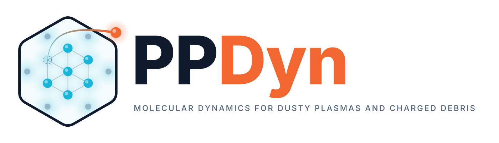
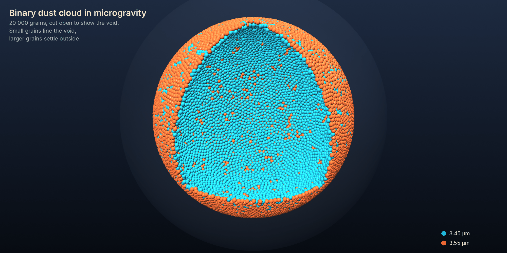
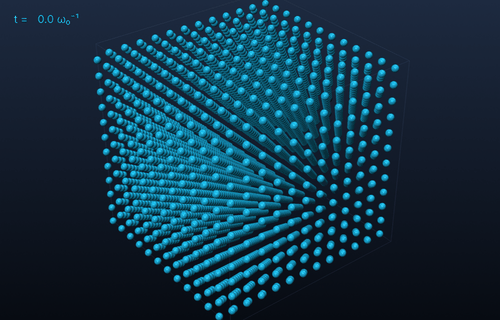
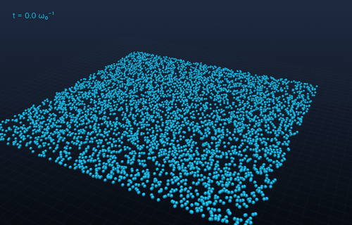
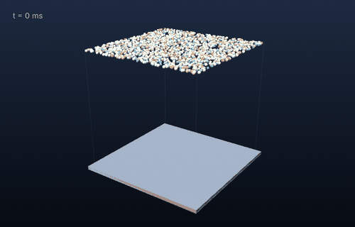
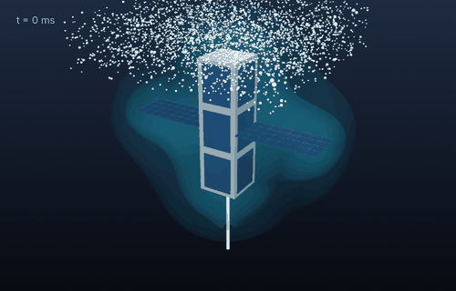
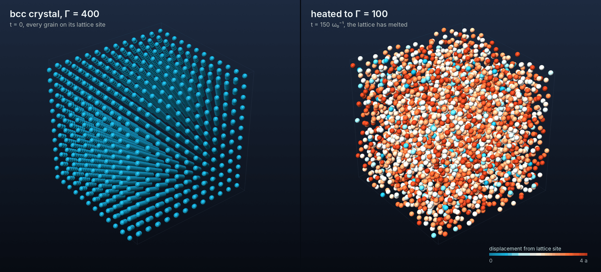
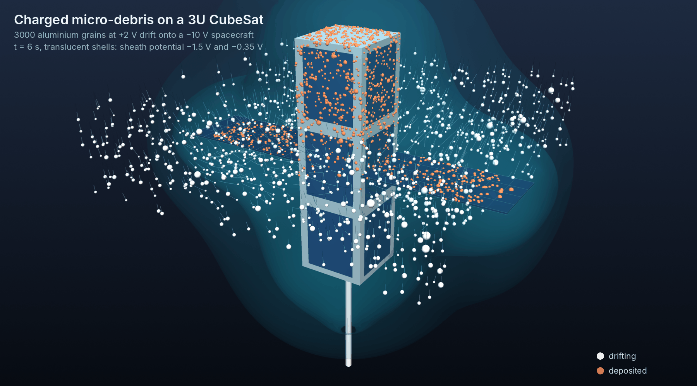
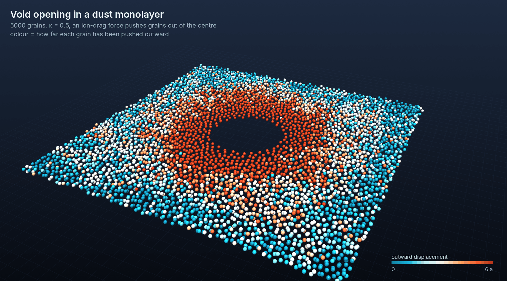

<p align="center">
  <picture>
    <source media="(prefers-color-scheme: dark)" srcset="docs/logo/ppdyn_logo_on_dark.png">
    
  </picture>
</p>

<p align="center">
  <a href="https://github.com/sayanadhikari/PPDyn/actions/workflows/ci.yml"></a>
  <a href="https://ppdyn.readthedocs.io/en/latest/?badge=latest"></a>
  <a href="https://pypi.org/project/PPDyn/"></a>
  <a href="https://zenodo.org/badge/latestdoi/349242730"></a>
</p>

<p align="center">
  <b>Parallel molecular dynamics for dusty plasmas and charged micro-debris</b><br>
  Yukawa interactions in O(N) &nbsp;·&nbsp; gravity, E-fields, ion and neutral drag &nbsp;·&nbsp; absorbing walls and spacecraft &nbsp;·&nbsp;
  grain size distributions &nbsp;·&nbsp; one input file &nbsp;·&nbsp; <code>pip install</code>
</p>

<p align="center">
  <br>
  <em>20 000 grains of two sizes in a microgravity plasma chamber, cut open. Electric confinement and ion drag
  balance at a radius that depends on the grain size, so the cloud forms a central void and separates into two shells:
  3.45 µm grains on the inside, 3.55 µm grains on the outside (example <code>dust_cloud</code>).</em>
</p>

# PPDyn: Plasma Particle Dynamics

PPDyn simulates dusty (complex) plasmas and charged micro-debris. Grains interact through a screened Coulomb (Yukawa) potential and feel gravity, electric fields, ion drag, neutral drag and thermal noise, solid objects and absorbing walls. Numba compiles the kernels to multithreaded machine code, and a linked-cell list makes the cost grow linearly with the number of particles.

**Version 2** merges every former development branch (dust fall, dust voids, dust clouds in microgravity, debris around spacecraft) into one code. You choose the physics in the input file. The previous code is kept on the [`legacy`](https://github.com/sayanadhikari/PPDyn/tree/legacy) branch.

## Contents

* [Gallery](#gallery)
* [Install](#install)
* [Quick start](#quick-start)
* [What it can simulate](#what-it-can-simulate)
* [Examples](#examples)
* [Output and post-processing](#output-and-post-processing)
* [Performance](#performance)
* [Validation](#validation)
* [Coming from PPDyn 1.x](#coming-from-ppdyn-1x)

## Gallery

Every picture below comes from one of the bundled examples, run as shipped (`ppdyn init <example>`).

<table>
<tr>
<td width="50%"><br><em><b>yukawa_crystal.</b> A bcc Yukawa crystal at Γ = 400 heated to Γ = 100: the lattice melts. Colour shows how far each grain has wandered from its lattice site.</em></td>
<td width="50%"><br><em><b>dust_void.</b> An ion-drag force opens a void in a dust monolayer. Colour shows how far each grain has been pushed outward.</em></td>
</tr>
<tr>
<td><br><em><b>dust_fall.</b> 2000 charged melamine grains fall through 10 Pa argon onto an absorbing electrode. Terminal speed grows with radius, so the large (orange) grains land first.</em></td>
<td><br><em><b>debris_cubesat.</b> Positively charged aluminium debris drifts onto a −10 V 3U CubeSat. The sheath field focuses the grains onto the body and solar wings, where they stick (orange).</em></td>
</tr>
</table>

<p align="center">
  <br>
  <em>The same crystal before and after heating: lattice channels at t = 0, a strongly coupled liquid at t = 150 ω₀⁻¹.</em>
</p>

<table>
<tr>
<td width="50%"><br><em>CubeSat with deployed wings and antenna mast; the translucent shells are the −1.5 V and −0.35 V surfaces of the screened sheath potential computed by <code>ppdyn field</code>.</em></td>
<td width="50%"><br><em>The fully opened void, about 15 a in radius, with the compressed ring of displaced grains around it.</em></td>
</tr>
</table>

Every image and animation here is made by PPDyn's own post-processing: `ppdyn render <run>.h5 --gallery docs/media` writes the set for one example, and `python docs/media/render/render_all.py runs` runs all five examples and renders them. Quantitative results for each example (radial distribution functions, landing times, radial profiles) are in [docs/source/examples.md](docs/source/examples.md).

## Install

```bash
pip install ppdyn                 # core
pip install "ppdyn[all]"          # plus the interactive 3D viewer and the AMG field solver
```

or from a clone with `pip install -e ".[dev]"`. Python 3.9 or newer; no compiler needed.

## Quick start

```bash
ppdyn init yukawa_crystal                 # copy a ready-to-run example
cd yukawa_crystal
ppdyn run input.toml --report             # run, then write figures and an HTML report
ppdyn view output/yukawa_crystal.h5       # interactive 3D viewer with a time slider
```

A complete input file is short and readable, and unknown or misspelt keys are rejected with a suggestion:

```toml
[domain]
box = [24.36, 24.36, 24.36]          # reduced units: a, 1/omega0, Q0, m0

[[species]]
count = 3456
[species.placement]
region = "lattice"
lattice = "bcc"
[species.velocity]
temperature = 0.0025                  # T = 1/Gamma, Gamma = 400

[interaction]
kappa = 1.0

[thermostat]
type = "langevin"
temperature = 0.01                    # heat to Gamma = 100: the crystal melts
gamma = 0.1

[time]
dt = 0.05
t_end = 150.0
```

Set `units.system = "SI"` to give every quantity in SI units (metres, seconds, kelvin, coulomb, pascal, V/m) and let PPDyn do the normalisation.

## What it can simulate

| feature | input |
|---|---|
| Yukawa or Coulomb interactions, automatic cutoff, linked cells or direct sum | `[interaction]` |
| Several species; fixed, normal, lognormal, uniform, binary or bimodal grain sizes; mass from density; charge ∝ r<sup>p</sup> or from surface potential | `[[species]]` |
| Loading in a box, sphere, shell, plane, bcc/fcc/sc lattice or from a file; Maxwellian, uniform or drifting velocities | `[species.placement]`, `[species.velocity]` |
| Periodic, reflecting, absorbing (stick or remove, optional charge neutralisation) or open walls, per face; spherical chambers | `[boundary]`, `[domain]` |
| Gravity, uniform and linear (sheath) E-fields, harmonic traps, constant ion-flow force | `[forces.*]` |
| Radial void force with optional time modulation | `[forces.void]` |
| Tabulated radial force or field profiles (measured or digitised data) | `[[forces.radial_table]]` |
| 3D electric field from PINC output or PPDyn's own field solver, trilinear interpolation | `[field]` |
| Solid objects (box, sphere, cylinder, CubeSat 1U to 6U with wings and antenna) that reflect or absorb | `[[objects]]` |
| Screened-Poisson field solver around charged objects | `ppdyn field`, `[field_solver]` |
| Epstein or constant neutral drag with exact Langevin thermal noise, Langevin or Berendsen thermostats | `[neutrals]`, `[thermostat]` |
| Hard-sphere contact collisions with restitution | `[collisions]` |
| Bit-exact checkpoint and restart | `run.restart`, `--restart` |

Every key is documented in the [input reference](docs/source/input_reference.md), which is generated from the code so it cannot drift out of date.

## Examples

`ppdyn init` lists them; each reproduces the physics of one former branch. Details and results are in [docs/source/examples.md](docs/source/examples.md).

| example | former branch | what you see |
|---|---|---|
| `yukawa_crystal` | `main` | a bcc Yukawa crystal heated through its melting point |
| `dust_fall` | `dust-fall` | charged grains fall through argon onto an absorbing, neutralising electrode; large grains land first |
| `dust_void` | `dust-void` | a monolayer dust crystal with an ion-drag void and ion flow |
| `dust_cloud` | `dust-exp` | a microgravity cloud of two grain sizes forms a void and segregates into two shells under tabulated electric and ion-drag forces |
| `debris_cubesat` | `debris`, `debris_dynamics` | charged micro-debris attracted to a charged 3U CubeSat; deposits outline the body and solar wings |

## Output and post-processing

Each run writes one HDF5 file with snapshots, a per-step history (energies, temperature per axis, particle counts, collected charge) and the full input text, plus a live `history.csv`. ParaView opens the accompanying `.xdmf` file directly.

```bash
ppdyn plot run.h5 report          # every figure and an index.html
ppdyn plot run.h5 rdf             # history, snapshot, rdf, vdf, msd, profiles, absorption
ppdyn movie run.h5 --view xz      # mp4 (or gif without ffmpeg)
ppdyn view run.h5                 # standalone interactive HTML
ppdyn render run.h5               # shaded 3D render (PNG), see below
ppdyn export run.h5 vtk           # also csv, xdmf
ppdyn watch output/               # live plot while running
```

From Python:

```python
from ppdyn.post import Run, rdf, msd
with Run("output/yukawa_crystal.h5") as r:
    r_, g = rdf(r.position(-1), r.L, r.periodic)
```

### 3D renders and animations

`ppdyn render` (needs `pip install "ppdyn[render]"`) draws a run the way the gallery does: shaded grains, trajectories, absorbing walls, objects such as the CubeSat and potential isosurfaces from the field file. Everything is read back from the output file, so no extra setup is needed. Runs of the bundled examples start from their gallery look; every option overrides it.

```bash
ppdyn render run.h5                                   # last snapshot -> run_render.png
ppdyn render run.h5 -t 0.044 -c radius --trails 16    # snapshot nearest 44 ms, coloured by grain size
ppdyn render run.h5 --cut quadrant --azimuth -40      # cut the cloud open towards the camera
ppdyn render run.h5 -c state --sheath -1.5 -0.35      # deposited vs drifting, sheath isosurfaces in volts
ppdyn render run.h5 --movie run.gif --orbit 90        # animation with a turning camera (.mp4 with ffmpeg)
ppdyn render run.h5 --gallery media/                  # the README images of a bundled example
```

Colours: `speed`, `radius` (a legend for up to four sizes), `species`, `displacement` (from the first snapshot, through periodic images), `outward` (radial push), `charge`, `state` (drifting or deposited) and `z`. The same is available from Python as `ppdyn.post.render.snapshot`, `compare` and `movie`. Headless machines render offscreen through EGL or OSMesa; on a Linux CI runner without a GPU use a virtual display (see the `render` job in `.github/workflows/ci.yml`).

## Performance

Time per step for a Yukawa system (κ = 1, a = 1 density) on two CPU cores; the legacy timings use the old `main` pusher on the same machine.

| particles | PPDyn 1.x (O(N²)) | PPDyn 2 (linked cells) | speed-up |
|---:|---:|---:|---:|
| 2 000 | 43 ms | 19 ms | 2.3× |
| 10 000 | 1.25 s | 70 ms | 18× |
| 30 000 | 11.1 s | 0.20 s | 56× |
| 464 000 (dust-exp size) | ≈ 44 min (extrapolated) | ≈ 3.1 s (extrapolated) | ≈ 850× |

Throughput grows with the core count; run `ppdyn bench` to measure your machine.

## Validation

The test suite (`pytest -q`, 35 tests) checks, among others:

* cell-list forces equal the direct sum to 10⁻¹⁰, including thin non-periodic slabs;
* NVE energy error 3×10⁻⁶ that falls 3.9× when dt is halved (second order);
* a Langevin gas reaches its target temperature within 2 %;
* free fall onto an absorbing floor lands at √(2h/g) to within one step, and the charge is collected;
* specular reflection from spheres, boxes and cylinders, and elastic head-on collisions;
* the field solver against the analytic screened sphere φ = V R/r e<sup>−(r−R)/λ</sup>;
* SI and reduced-unit runs of the same system give identical trajectories;
* restart from a checkpoint reproduces an uninterrupted run bit for bit;
* legacy inputs from every branch convert and run.

The numerical methods, units and the legacy bugs that were fixed on the way are described in [docs/source/numerics.md](docs/source/numerics.md).

## Coming from PPDyn 1.x

```bash
ppdyn convert input.ini     # writes input.toml with NOTE comments for every judgement call
```

See [docs/source/migration.md](docs/source/migration.md) for where each branch's features went and the behaviour changes to be aware of.

## Contributors

* [Sayan Adhikari](https://github.com/sayanadhikari), IFE, Norway
* [Rupak Mukherjee](https://github.com/RupakMukherjee), PPPL, USA
* [Gaute Holen](https://github.com/GauteHolen), UiO, Norway (dust clouds, size distributions)
* [Rinku Mishra](https://github.com/rinku-mishra), IPR, India (dust voids, debris dynamics)

Contributions are welcome; see [CONTRIBUTING.md](CONTRIBUTING.md). If you use PPDyn, please cite it using [CITATION.cff](CITATION.cff).

## License

MIT, see [LICENSE](LICENSE).
