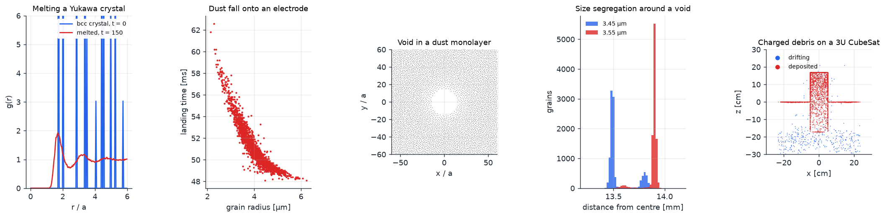
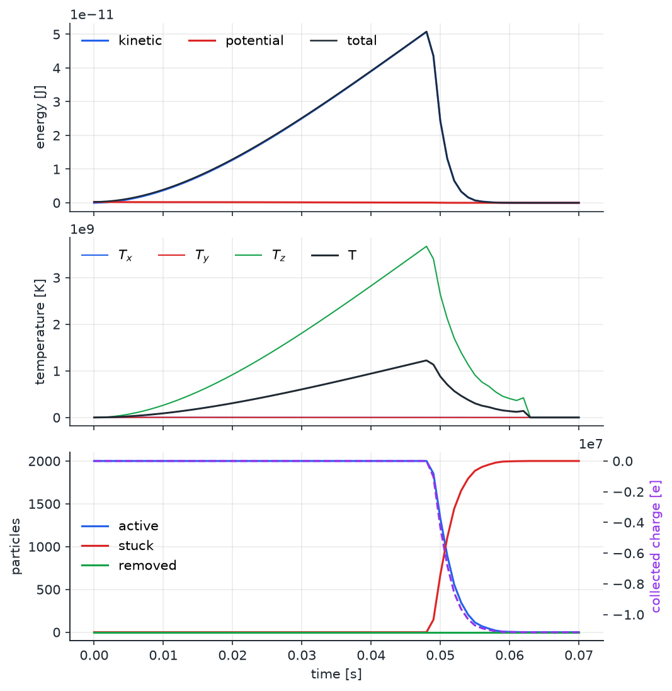
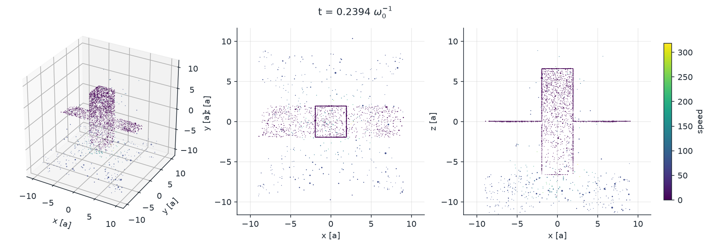

# Examples

`ppdyn init <name>` copies an example into a new folder; `ppdyn run input.toml --report` runs it and writes figures plus `output/report/index.html`. Run times below are for two CPU cores.

## yukawa_crystal (former `main`)

3456 grains start on a bcc lattice at Γ = 400 with κ = 1, well inside the solid phase (melting near Γ ≈ 217). A Langevin thermostat heats them to Γ = 100 and the crystal melts; the run then continues in NVE. The initial g(r) shows the bcc shells at 1.78, 2.03, 2.88 and 3.38 a (ideal 1.76, 2.03, 2.87, 3.37); the final g(r) is that of a strongly coupled liquid. With `--set thermostat.temperature=0.0033` (Γ = 300) the crystal survives. About 90 s.

Note: quenching a Yukawa liquid below melting in a small periodic box usually gives a supercooled liquid within practical run times, because homogeneous nucleation is slow. Melting is the reliable demonstration.

## dust_fall (former `dust-fall`)

2000 melamine grains (r = 4 ± 0.6 µm, surface potential −2 V, about 5500 e) are released at the top of a 1 cm box in 10 Pa argon. They fall under gravity against Epstein drag, repel each other, and stick to the absorbing floor, where they lose their charge. Because the terminal speed g/γ grows linearly with radius, large grains land first (48 ms) and small ones last (63 ms). The history panel shows the collected charge stepping down as grains arrive. About 5 s.

## dust_void (former `dust-void`)

5000 grains in a monolayer held by a harmonic vertical confinement, with κ = 0.5, Langevin neutral damping at Γ = 100, a cylindrical void force A e−r/λ and a weak ion-flow force. A void of radius about 15 a opens in the centre of the crystal. Set `[forces.void] modulation` and `omega` for a breathing void. About 80 s.

## dust_cloud (former `dust-exp`)

20 000 grains of two sizes (3.45 and 3.55 µm) in a spherical chamber of radius 18.5 mm, 30 Pa argon, Debye length 300 µm. The digitised electric force (∝ charge ∝ r) pushes inward and the ion drag (∝ r²) pushes outward; the balance radius depends on the grain size. The cloud forms a 13.5 mm void and segregates into two thin shells: 3.45 µm grains at 13.55 mm and 3.55 µm grains at 13.89 mm. About 150 s; increase `count` towards the original 464 000 grains on a larger machine.

## debris_cubesat (former `debris`, `debris_dynamics`)

A 3U CubeSat with deployed 20 cm wings and an antenna mast sits at −10 V in a plasma with a 5 cm Debye length. The first run solves the screened field on a 72³ grid (about 5 s) and saves `field.h5`. 3000 lognormal aluminium grains charged to +2 V drift towards the spacecraft at 3 cm/s, are focused by its field and stick where they hit: 2614 of 3000 strike it within 15 s (1954 on the body, 658 on the wings, 2 on the antenna). Impact times and the struck primitive are in `final/absorb_time` and `final/hit_object`. To use a PINC field instead, point `[field] file` at the PINC `E.grid.h5` and set `format = "pinc"`. About 60 s.

